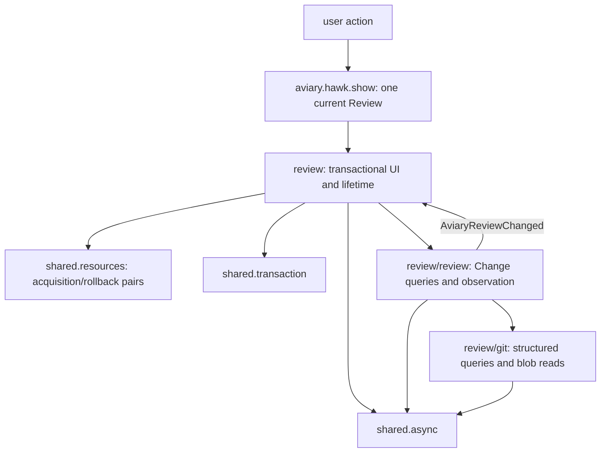

# Hawk architecture

The [Hawk entry](../../lua/aviary/hawk/init.lua) owns the current Review instance.
The [Review UI](../../lua/aviary/hawk/review/init.lua) owns its concrete Tab and
retained list state. Interface contracts belong to those entries and the
[Review data entry](../../lua/aviary/hawk/review/review.lua).

Session comparison choices live outside the Tab and survive UI closure.
[Configuration](../../lua/aviary/hawk/config.lua) supplies one keymap/action set,
which Review binds to its concrete Tab after configuring the list.

## Transactional creation and lifetime

Review creates its complete layout in a shared
[transaction](../../lua/aviary/shared/transaction.lua), using native acquisition
and rollback pairs from [shared resources](../../lua/aviary/shared/resources.lua).
It owns the list and version buffers/windows, its instance group, independent
list/body work and repository observation. Failed creation rolls back resources
and restores source focus; Hawk publishes the instance only after success.

The instance group contains width observers, User change subscriptions and
lifetime listeners. Review subscribes before starting observation, registers its
stop function for rollback and queues the first metadata refresh. The UI
transaction ends with synchronous creation; the queued refresh runs afterward.

Closure removes the group, stops observation and list/body reads, clears list keys
and releases window/diff settings synchronously. The close callback clears Hawk's
current instance before deferred native reclamation removes buffers and the tab.
That reclamation captures native IDs so the initiating native operation can
finish without retaining the ended object. If native last-tab exit is cancelled,
the ended instance stays stopped; reopening creates a fresh one.

## Refresh, rendering and displayed versions

Refresh coalesces queued starts and cancels superseded metadata flows. Each flow
captures its repository and comparison choices before yielding, reads Changes and
draws the result before committing its Snapshot. Read or drawing failure leaves
the previous Snapshot available. Outside Git, the data layer returns an empty
comparison that the UI commits as an empty Snapshot.

Width observers redraw the retained original Changes without starting or
cancelling metadata reads. Rendering and refresh preserve the native view;
[Item contracts](../../lua/aviary/hawk/init.lua) define the rendered output.

Metadata and body flows have independent cancellation. Refresh replaces list
membership without replacing displayed versions; a jump reads the selected
Change's captured blobs and labels into the reused version buffers. The Git layer
starts both blob processes before waiting and returns their contents together.
Process handles and output collection stay inside that layer.

Revision pickers capture repository and choice data without retaining a Tab.
Confirmation changes session choices and emits a User event; active instance
groups receive it and queue refresh. A delayed selection from another repository
is ignored.

## Query layers and repository observation

The UI owns flows around metadata, body and revision-candidate queries. The
[Review data module](../../lua/aviary/hawk/review/review.lua) borrows each query's
context and owns comparison rules, Change behavior and observation. The
[Git module](../../lua/aviary/hawk/review/git.lua) owns command construction,
execution options and parsing; its owned results transfer to Review. Git has no
Change or UI dependency.

Each UI owns one observation lifetime. The data module owns global-cwd resolution,
its DirChanged observer and the current repository binding. Directory changes
replace the binding and emit AviaryReviewChanged; outside Git, only the directory
observer remains. Filesystem bursts pass through the binding's debounce before
emission. UI subscriptions live in the instance group.

A binding owns discovery cancellation separately from its completed Watch.
Discovery obtains metadata directories asynchronously, then Watch acquires its
debounce and native directory handles in a synchronous transaction. Publication
happens only after success. Replacing a binding suppresses its pending discovery,
late filesystem events and queued debounce work.

Discovery and acquisition failures reach Async's default notification after
cleanup. Filesystem callback errors close the binding and raise on the main loop;
the directory observer remains for a later cwd change. Stopping observation
releases both the directory observer and current binding. Manual refresh remains
independent of observation and resolves the repository anew.

See the [glossary](./glossary.md), [decisions](./decisions.md) and
[user manual](../hawk.md).
