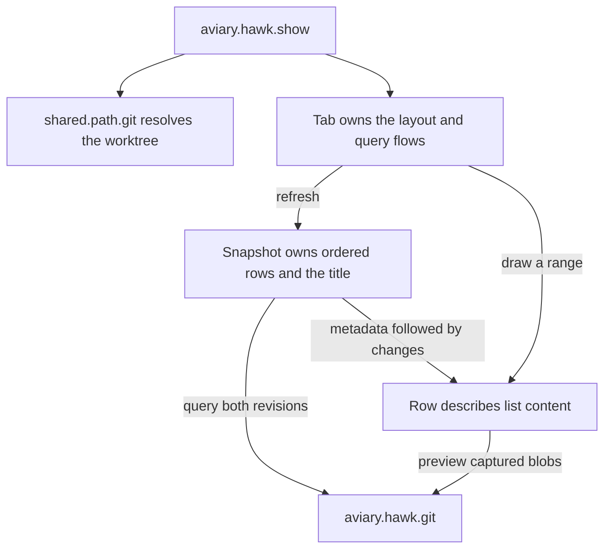

# Hawk architecture

The [Hawk entry](../../lua/aviary/hawk/init.lua) resolves the opening worktree
and constructs the Tab with the default diff Snapshot. Each Tab owns its
Snapshot, three windows and buffers, and both query cancellations. The Snapshot
holds the fixed worktree root. [Configuration](../../lua/aviary/hawk/config.lua)
supplies the actions each Tab binds at construction.

## Comparing and previewing

Each bottom buffer line maps to one row of the active
[Snapshot](../../lua/aviary/hawk/snapshot/init.lua). The diff implementation's
metadata rows hold the `style`, `old` and `new` drafts. The default action
captures the selected row before opening the prompt or choice list. Confirmation
updates that row and asks the Tab to redraw it.
[Rows](../../lua/aviary/hawk/snapshot/row.lua) supply text and extmark
descriptions. The Tab applies them over the requested line range.
The `toggle_check` action updates the selected diff row's read state and asks
the Tab to redraw that line.

On refresh the Snapshot captures the drafts, queries the
[Git module](../../lua/aviary/hawk/git.lua), and replaces its change rows and
title after a successful query. The `merge-base` style issues one three-dot diff
from the common ancestor to `new`. The Tab redraws the change range. A Git error
leaves the last result in place. Changing the `style` row only updates a draft;
the Tab never installs a new Snapshot while a Review is open. Snapshot switching
remains reserved in the interface and currently raises.

On a change row, Enter starts a preview using the captured blob IDs. Git starts
both blob reads before awaiting either. The row writes the results or the
non-text descriptions to the Tab's two preview buffers. A new selection
replaces pending preview work. Refresh and preview have independent flows.

## Construction and closure

Review uses [native resource factories](../../lua/aviary/shared/resources.lua)
inside a [transaction](../../lua/aviary/shared/transaction.lua). The complete
layout, input labels and mappings are installed before `hawk.show()` returns.
The result list starts empty. The first query starts with a manual refresh.

Closure removes the instance's augroup and list mappings, cancels reads and
releases window locks synchronously. Native reclamation uses the captured IDs
after the originating operation finishes. If the last-tab exit is refused or
cancelled, the ended Review stays stopped.

See the [glossary](./glossary.md), [decisions](./decisions.md) and
[user manual](../hawk.md).
