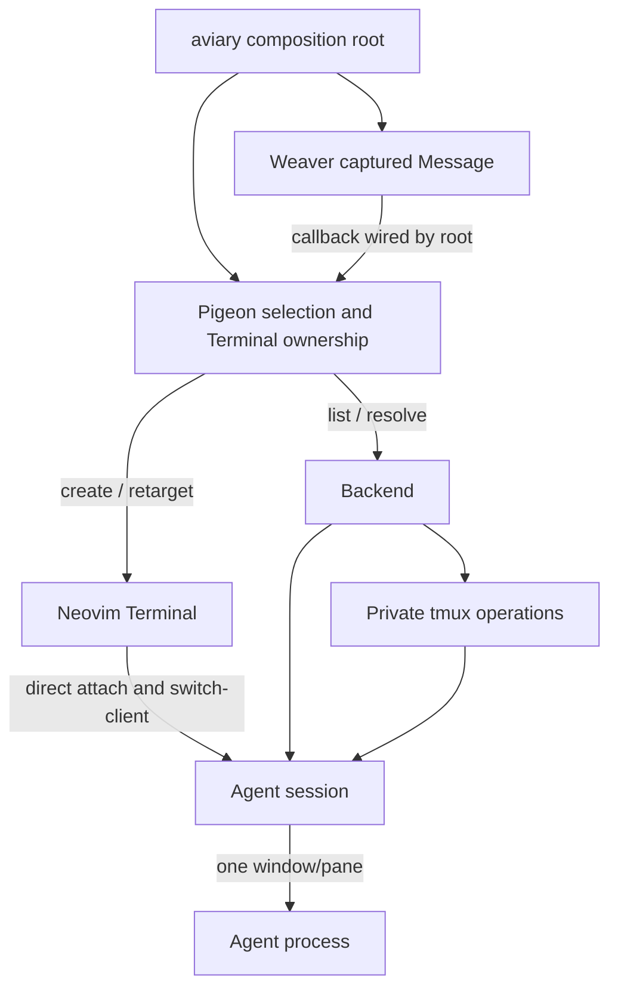

# Pigeon architecture

The root composes Weaver and Pigeon without feature dependencies. Pigeon owns
one Terminal instance. The Backend owns Agent discovery and creation; the
Terminal owns editor resources and the tmux client attached to the current
Agent. The [Pigeon entry](../../lua/aviary/pigeon/init.lua) and
[backend entry](../../lua/aviary/pigeon/backends/init.lua) own caller
contracts. Only picker confirmation is deferred; acquisitions and delivery are
synchronous.

## Selection and delivery

Backend discovers Agent windows marked with `@pigeon_session` and
`@pigeon_tool`, filters tools absent from local configuration, and appends
creation Choices. Resolving a tool Choice captures cwd and acquires one
persistent Agent session with one window and pane. The private
[tmux module](../../lua/aviary/pigeon/backends/tmux/cli.lua) reads the pane,
session name, tool key and launch cwd using length-prefixed fields, preserving
separators in tool names and paths.

The first selection creates the Terminal and attaches its tmux client directly
to the Agent session. A later selection asks the current Agent to move that same
client with `switch-client -c <pty> -t =<session>`, then replaces the stored
Agent only after the native switch succeeds. The Terminal buffer, attach job and
client remain the same. Each editor owns its client, so its choice does not move
another editor's client; multiple clients may attach to the same Agent and share
its input and output.

Pigeon stores the current Agent on the Terminal. It does not query tmux before
delivery: the Agent session has one window, and Pigeon changes the client only
through a successful retarget. Moving the client outside Pigeon is unsupported.
A send evaluates the borrowed Message against the current Agent's launch cwd and
current local tool formatter, then pastes into that Agent's pane. Hidden
Terminals keep their client and Agent, so sending needs no UI change. Cancellation
and failures preserve the existing Agent and report through
[protect](../../lua/aviary/shared/protect.lua); requests are never replayed.

## Resource lifetimes

Each Agent has an independent persistent session with one window, surviving all
editor clients. The session sets `destroy-unattached=off` and
`detach-on-destroy=on`; the window sets `remain-on-exit=off`. After all clients
leave, the Agent remains. When the Agent pane exits, its window and session
disappear and all attached clients end.

The Terminal owns a buffer, its action keymaps, a buffer-local `TermClose`
listener, an attach job and the client PTY. The floating window and its listener
group are acquired separately when the Terminal is shown; the window fixes its
Terminal buffer with `winfixbuf`. Closing the Neovim window releases only the
window and its listeners; the buffer, job and client remain. Reopening
recalculates geometry.
Pigeon does not listen to `VimResized`; a visible float keeps its size until it
is hidden and reopened. Tmux applies its existing window-size policy to attached
clients.

`TermClose` owns cleanup. Its callback snapshots and clears Pigeon state before
touching resources. For a normal job exit or `jobstop` (`status >= 0`), it
deletes the buffer and releases the window listener group; the fixed float
closes with its buffer, so cleanup calls no window API. Neovim's external
`close_buffer()` path reports `status == -1`; the outer deletion already owns
the window and buffer, so the callback only clears state. Cleanup releases the
listener group itself rather than relying on `WinClosed`; external deletion may
trigger `WinClosed` first, and both paths release state idempotently.

Only one Terminal exists at a time. Entry creates one only when state is empty,
and failed retargets preserve the previous Agent. `TermClose` is registered after
all fallible acquisition succeeds, and its callback clears state before using
captured resources. A reentrant callback therefore cannot clear a newer
Terminal's state, so no separate instance-ownership check is needed.

## Acquisition and configuration

`Terminal.create` uses [transactions](../../lua/aviary/shared/transaction.lua)
and [resource factories](../../lua/aviary/shared/resources.lua) to acquire the
buffer, start the attach job in that buffer with `nvim_buf_call` and read its
client PTY. No window is required: `nvim_buf_call` makes the buffer current only
for `jobstart(term = true)`. Buffer acquisition failure rolls back the buffer;
the window and its listeners are acquired separately on show. Backend creates
and configures Agent sessions through the same transaction model. `Agent.attach`
only constructs the direct attach argv; `Agent.retarget` only switches the
existing client.

Configuration owns tools, reference policy, float options and action bindings,
without acquiring resources. Formatting resolves on each send; geometry resolves
when a window is opened or reopened, while action keymaps are installed when the
Terminal is created. The [health module](../../lua/aviary/pigeon/health.lua)
diagnoses dependencies read-only. Native operations use the existing host server
and inherit its configuration; the nested client clears `TMUX` and uses tmux's
default socket. Session targets use `=` exact matching so a stale Agent fails
instead of resolving by prefix.

See the [glossary](./glossary.md), [decisions](./decisions.md) and
[user manual](../pigeon.md).
