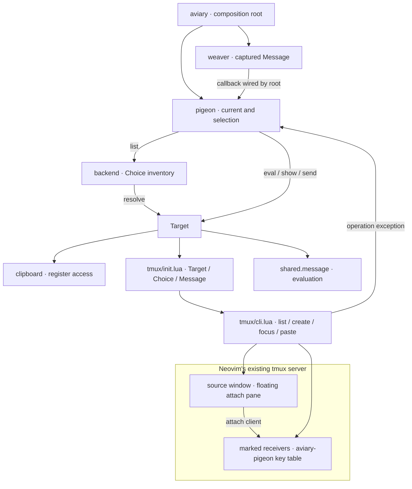

# Pigeon architecture

The root composes Weaver and Pigeon through captured Messages; features remain
independent. The [root entry](../../lua/aviary/init.lua),
[Pigeon entry](../../lua/aviary/pigeon/init.lua) and
[backend entry](../../lua/aviary/pigeon/backends/init.lua) own interface contracts.
Native selection is the deferred continuation; tmux execution and transactional
acquisition are synchronous.

## Selection, evaluation and recovery

Backends provide an inventory of existing Targets and tool creation Choices.
Pigeon owns selection and current; a backend acquires a new receiver only after
its Choice is confirmed. Pigeon commits only a fully resolved Target.

Current is a selected destination reference and can outlive the receiver.
Discovery failure or cancellation preserves it; resolution and action failures
clear it and end the request. [Shared protect](../../lua/aviary/shared/protect.lua)
owns exception notification while Pigeon owns state recovery. Backends propagate
operation errors, and failed requests are not replayed.

The selected Target evaluates the captured Message using its formatting context.
Pigeon starts delivery only after complete evaluation succeeds, keeping partial
Message results out of the destination. The
[shared Message module](../../lua/aviary/shared/message.lua) owns evaluation;
Pigeon owns ordering and recovery around it.

## Native data and business composition

The [tmux entry](../../lua/aviary/pigeon/backends/tmux/init.lua) owns receiver
identity, tool lookup and reference formatting. Its private
[CLI](../../lua/aviary/pigeon/backends/tmux/cli.lua) owns native command execution,
record encoding/decoding and receiver/view resource operations.

| Target field | Native field |
| --- | --- |
| instance | session_name |
| tool | @pigeon_tool |
| cwd | pane_start_path |

CLI discovery returns structured native records. The entry converts them into
Targets, filters tools absent from local configuration and appends tool creation
Choices. A nonempty @pigeon_tool establishes receiver ownership and tool identity,
so window renames do not affect discovery. Launch cwd remains stable when the
agent changes directory, allowing rediscovery to reconstruct reference context.

Formatting uses the target's captured launch cwd and the sending editor's current
same-named tool configuration. Clipboard evaluation uses its own context through
the same Message interface. Neither backend owns Pigeon's current selection.

## Host server and independent lifetimes

Receivers and floating views use Neovim's existing tmux server. TMUX and TMUX_PANE
supply trusted host context; the nested attach client reconnects to that same host
socket with TMUX cleared. Host prerequisites belong in the
[manual](../pigeon.md#backends).

Each receiver is a detached session with one agent pane. It outlives editors,
views, source windows and source sessions; agent exit removes the receiver, and
host server shutdown stops all receivers. Server options and user hooks remain
shared, including extended-key behavior.

CLI discovers each view in its source window by the @pigeon_source pane mark.
Native ownership distinguishes editors sharing a window and reflects manual
closure without cached Lua display state. Reuse replaces the attach client while
preserving the receiver process and draft; switching targets can reuse the same
view. Views attached to one receiver share its draft and terminal size.

The dedicated aviary-pigeon key table is shared server state. Each show configures
it and selects it for the receiver before acquiring the view; it is outside the
view transaction. Its latest configuration applies to receivers using that table.

## Transactions and failure ownership

CLI acquires and configures a receiver in one transaction. It also owns the view
transaction, covering acquisition, configuration, dimensions, placement, attach
and focus for both new and reused views. Shared resources provides native Neovim
factories; tmux resources remain private to CLI.

Failed view acquisition or configuration attempts cleanup and propagates the
operation error. Rollback closes an acquired pane even when reused, while the
receiver remains available for another view. Pigeon then invalidates current
without taking ownership of the receiver's lifetime.

Delivery uses existing resources and has no view acquisition transaction. Its
command errors preserve the existing display and reach Pigeon's action recovery.
Native attach-client exit removes the view; editor exit registers no cleanup, so
an abandoned view remains available for manual closure.

## Configuration and diagnostics

Setup merges and validates configuration without acquiring resources. Operations
resolve selected behavior when used, including dimensions and reference formatters.
The [health module](../../lua/aviary/pigeon/health.lua) owns read-only context,
version and outer close-key diagnostics; it acquires no receiver or view. Backend
operations trust the host context and propagate command errors to Pigeon.

See the [glossary](./glossary.md), [decisions](./decisions.md) and
[user manual](../pigeon.md).
