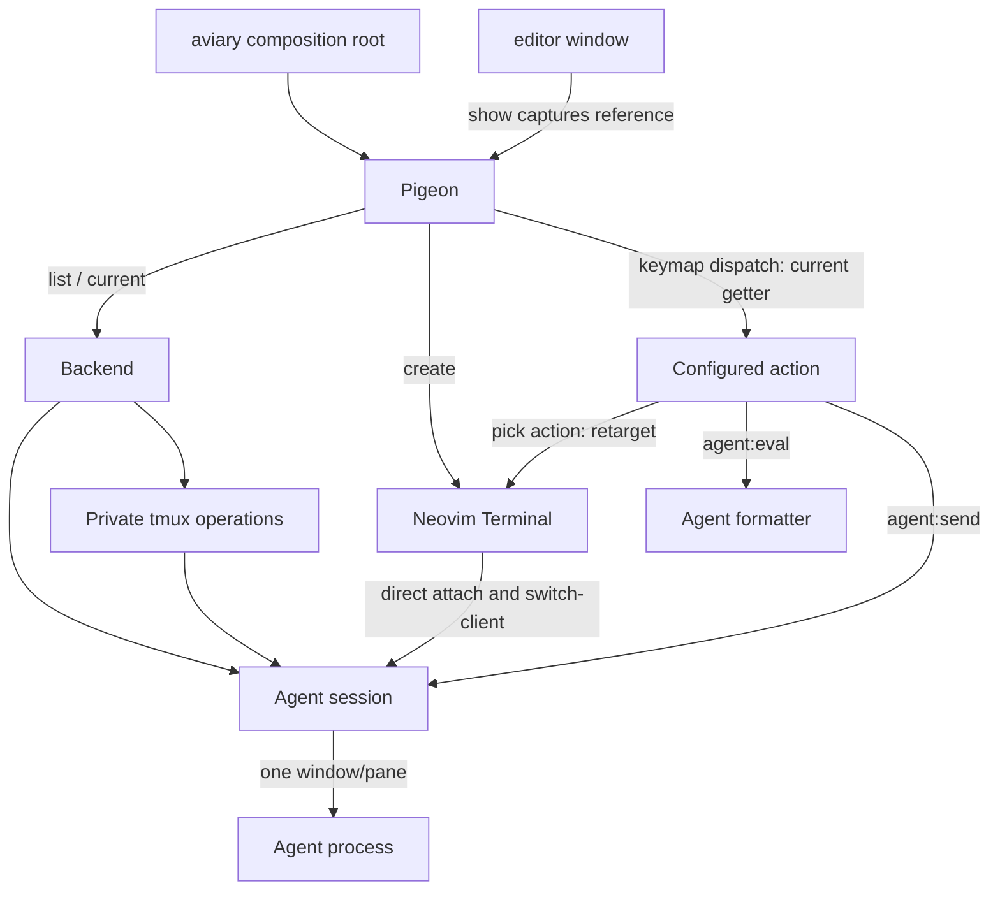

# Pigeon architecture

The root composes the public features without feature dependencies. Pigeon owns
one Terminal instance. Actions are configured in Pigeon's options and installed
as Terminal-buffer keymaps; the Backend owns Agent discovery and creation; the
Terminal owns editor resources and the tmux client. The current Agent is
resolved from that client when an action needs it. The
[Pigeon entry](../../lua/aviary/pigeon/init.lua),
[config entry](../../lua/aviary/pigeon/config.lua) and
[backend entry](../../lua/aviary/pigeon/backends/init.lua) own caller
contracts. Only picker and template confirmation are deferred; acquisitions and
delivery are synchronous.

## Reference capture

`show()` captures the current editor location before opening any picker or
focusing the Terminal: the inclusive whole-line Visual range after leaving
Visual mode, or the cursor row otherwise. The captured path is snapshotted, so
the reference is plain data rather than a buffer handle. Showing the Terminal
from an editor refreshes the reference; invoking `show()` from the Terminal
itself, or running the `pick` action, preserves it.

The same reference is passed to every action keymap invocation. Actions that
need another location can construct a new reference table; they do not mutate
the captured one.

## Action dispatch

`Terminal.create` installs buffer-local keymaps for Terminal mode. Each callback
calls `handler(current, state.reference)` with a lazy getter that resolves the
Agent displayed by the Terminal's client. Built-in `buffers`, `close`, `pick`
and `prompt` handlers live in the config defaults. User handlers merge over those
defaults, and Terminal creation looks up each mapped action in the resulting
handler table. Handlers that do not call the getter perform no tmux lookup.

The built-in prompt action resolves the current Agent once, reads the running
`prompts` and `resolvers`, captures them with the reference, opens
`vim.ui.select`, and concatenates literal template segments with resolver
strings. Built-in resolvers render references through `agent:eval`; custom
resolvers receive the Agent and may do the same. The asynchronous selector
callback renders all content before one `agent:send`, wrapped in
[protect](../../lua/aviary/shared/protect.lua).

The built-in pick action passes the resolved current Agent to `Backends.list`
so the backend can prioritize that Agent and its launch cwd. The selector marks
the current Agent. After confirmation, the action materializes the selected
Choice and asks the resulting Agent to move the Terminal's client.
It reads the client from the buffer-local terminal job
and does not create a Terminal or change focus. Picker discovery and
the asynchronous selector callback are wrapped in
[protect](../../lua/aviary/shared/protect.lua); resolution failure warns once and
does not open the selector.

The built-in buffers action lists listed, named buffers with an empty `buftype`
and resolves the current Agent once. It opens `vim.ui.select`; confirmation
renders a whole-file reference and sends it, while cancellation only resumes
Terminal input. Buffer enumeration is editor-local and synchronous, so the action
adds no picker interface or optional dependency. Its selector callback is
wrapped in [protect](../../lua/aviary/shared/protect.lua).

Files actions are user configuration, not Pigeon core. File discovery, previews
and selection rules depend on the picker, so these actions resolve the current
Agent, open their picker, collect absolute paths, render each with `agent:eval`,
join the strings, and call `agent:send`. Pigeon defines no picker interface and
adds no optional picker dependency.

## Backend and delivery

Backend discovers Agent windows marked with `@pigeon_session` and
`@pigeon_tool`, filters tools absent from local configuration, and appends
creation Choices. Materializing a tool Choice captures cwd and acquires one
persistent Agent session with one window and pane. The private
[tmux module](../../lua/aviary/pigeon/backends/tmux/cli.lua) reads the pane,
session name, tool key and launch cwd using length-prefixed fields, preserving
separators in tool names and paths. `Backends.current(client)` runs one
`list-clients` query, matches the exact client PTY, and returns the Agent in that
client's current window. It raises when the client is absent or its window is not
a Pigeon Agent.

The first selection creates the Terminal and attaches its tmux client directly
to the Agent session. The pick action asks the selected Agent to move that same
client with `switch-client -c <pty> -t =<session>`; the Terminal buffer, attach
job and client remain the same. The Terminal does not store an Agent, so the tmux
client is the source of truth for subsequent actions. Each editor owns its
client, so its choice does not move another editor's client; multiple clients may
attach to the same Agent and share its input and output.

`Agent:eval(reference)` resolves the snapshot path relative to the Agent's launch
cwd, calls the current local tool formatter, and raises when the path is empty or
the formatter returns no text. `Agent:send(text)` pastes the result. An action
resolves the Agent through its getter, so delivery follows the client's current
session; hidden Terminals keep their client, and a later action resolves the same
Agent without focusing. Exact client matching prevents another editor's client
from being used when the Terminal's client is not attached. Failures that the
built-in actions own report through
[protect](../../lua/aviary/shared/protect.lua); requests are never replayed.

## Resource lifetimes

Each Agent has an independent persistent session with one window, surviving all
editor clients. The session sets `destroy-unattached=off` and
`detach-on-destroy=on`; the window sets `remain-on-exit=off`. After all clients
leave, the Agent remains. When the Agent pane exits, its window and session
disappear and all attached clients end.

The Terminal owns a buffer, its action keymaps, a buffer-local `TermClose`
listener, an attach job and the client PTY. The floating window and its listener
group are acquired separately when the Terminal is shown; the window fixes its
Terminal buffer with `winfixbuf`. Closing the Neovim window releases only the
window and its listeners; the buffer, job and client remain. Reopening
recalculates geometry.
Pigeon does not listen to `VimResized`; a visible float keeps its size until it
is hidden and reopened. Tmux applies its existing window-size policy to attached
clients.

`TermClose` owns cleanup. Its callback snapshots and clears Pigeon state before
touching resources. For a normal job exit or `jobstop` (`status >= 0`), it
deletes the buffer and releases the window listener group; the fixed float
closes with its buffer, so cleanup calls no window API. Neovim's external
`close_buffer()` path reports `status == -1`; the outer deletion already owns
the window and buffer, so the callback only clears state. Cleanup releases the
listener group itself rather than relying on `WinClosed`; external deletion may
trigger `WinClosed` first, and both paths release state idempotently.

Only one Terminal exists at a time. Entry creates one only when state is empty;
a failed pick retarget leaves the client attached to its previous Agent.
`TermClose` is registered after all fallible acquisition succeeds, and its
callback clears state before using captured resources. A reentrant callback
therefore cannot clear a newer Terminal's state, so no separate
instance-ownership check is needed.

## Acquisition and configuration

`Terminal.create` uses [transactions](../../lua/aviary/shared/transaction.lua)
and [resource factories](../../lua/aviary/shared/resources.lua) to acquire the
buffer, start the attach job in that buffer with `nvim_buf_call` and read its
client PTY. No window is required: `nvim_buf_call` makes the buffer current only
for `jobstart(term = true)`. Buffer acquisition failure rolls back the buffer;
the window and its listeners are acquired separately on show. Backend creates
and configures Agent sessions through the same transaction model. `Agent.attach`
only constructs the direct attach argv; `Agent.retarget` only switches the
existing client.

Configuration owns tools, formatters, float options, action bindings, templates
and resolvers, without acquiring resources. Formatting resolves on each render;
geometry resolves when a window is opened or reopened, while action keymaps are
installed when the Terminal is created. The show bootstrap picker creates a
Terminal from its Choice, while the pick action retargets the existing client;
their selector code is intentionally separate because only the action marks the
current Agent. Prompt templates and resolvers are captured when the action
starts, after resolving the current Agent once and before the selector changes
focus. The [health module](../../lua/aviary/pigeon/health.lua) diagnoses
dependencies read-only. Native operations use the existing host server and
inherit its configuration; the nested client clears `TMUX` and uses tmux's
default socket. Session targets use `=` exact matching so a stale Agent fails
instead of resolving by prefix.

See the [glossary](./glossary.md), [decisions](./decisions.md) and
[user manual](../pigeon.md).
