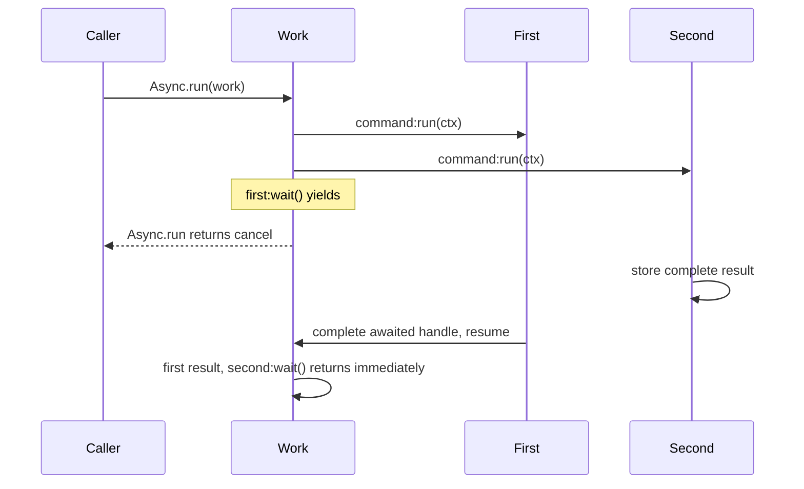

# Async command execution

The [module entry](../../../lua/aviary/shared/async.lua) owns interface contracts
and usage examples. See the [decisions](./decisions.md) for design trade-offs.

## Execution and completion

Each flow has one context owning its coroutine, running process IDs and awaited
handle. Commands start native jobs and return handles that retain their output.
Several jobs can share a flow; suspending on one handle does not stop its siblings.

Native completion stores the result and removes the process from the running set
before resuming work. Only the awaited handle resumes the coroutine; other
completed handles retain results until work reaches them. Exit checking happens
in wait, so command failures join parsing and result handling in the work's error
path.

## Flow termination

Completion, failure and cancellation detach the coroutine and awaited handle
before attempting to stop remaining jobs. Late callbacks can record output and
exit but cannot resume ended work. Native callbacks, handles and cancellation
functions can therefore outlive the coroutine stack without retaining it.

LuaJIT cannot unwind a suspended coroutine. Detaching it makes the stack
collectible; process cleanup belongs to the context rather than statements after
the suspended wait. The caller-facing cancellation limits are defined at the
[module entry](../../../lua/aviary/shared/async.lua).

Work failure reaches the error handler after process cleanup. Cleanup errors
remain associated with the work failure; error-handler failures escape that
path. The default handler uses [shared notify](../../../lua/aviary/shared/notify.lua),
which owns notification delivery and the aviary title.

## Native processes and caller work

jobstart owns process channels, buffering and native termination. Lua handles
retain decoded complete results while their context tracks only running jobs.
This separates native process lifetime from coroutine reachability.

Command-specific sequencing, parsing and successful result handling stay with
callers such as the [Review Git module](../../../lua/aviary/hawk/git.lua).
The module owns execution mechanics rather than a streaming queue or general task
scheduler.
